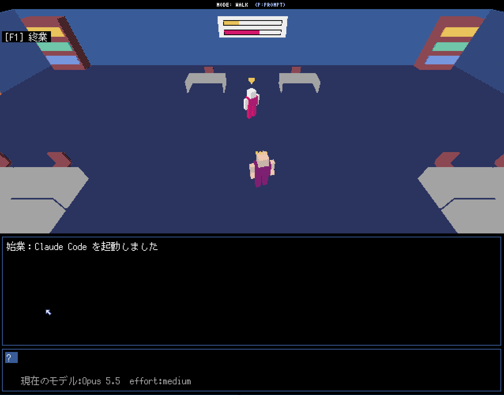

# pyxelcube_agents

[日本語](README.md) | English

A small 3D office built with Pyxel Cube (the 3D feature of Pyxel 3.0). Characters walk around their seats, sit down, and go to destinations (coffee, bookshelf, plants). With the office layout (the default), it connects to a real Claude Code running inside tmux (a tool that runs several screens in one terminal), and when you type a prompt in the tool's input box, the characters in the office start working.



Version: 0.90

## Important notes

Be sure to read these before use.

1. **This software runs a real Claude Code.** When you choose "Allow (Y)" or "Always allow (A twice)" in the tool, Claude Code really performs that work (rewriting files, running commands, and so on). Depending on the content, "Always allow" adds a rule to `.claude/settings.local.json` in the work folder, and it stays even after you close the tool.
2. **Started with no arguments, the tool opens in the state connected to Claude Code.** Claude Code starts inside tmux only when you clock in with F1 (it does not start just because the tool is started). To only watch without connecting, add `--no-claude`.
3. The values you choose in the `/model` and `/effort` menus are saved in Claude Code's settings as the default for new sessions. While the command window (the window that opens when you send text starting with `/`) is open, keys go to Claude Code as they are. If you change settings with `/config` and similar commands, they really change.
4. To show the usage limits, each time Claude finishes one reply, the tool sends `/usage` to tmux, reads the screen, and closes it.
5. The tool reads the text on the tmux screen (`capture-pane`). What appears on the screen (such as the contents of a file) is read by the tool and displayed.
6. **This tool works by reading the English text on Claude Code's screen.** Examples are `Do you want to` on the permission screen, `Current session` in `/usage`, and `with medium effort` in the status line. With Claude Code 2.1.330, the screen stayed in English even when the language setting or the OS language was set to Japanese (confirmed on the real thing. Only Claude's replies and the description text on the permission screen change). With a version of Claude Code that translates its screen, the permission, usage-limit and model displays may stop working.
7. `/exit` and `/quit` cannot be sent from the tool's input box. To finish, use F1 to clock out (it has Claude write a handoff memo and then closes). Closing with the window's X also works, but it waits up to 300 seconds for the handoff.
8. There is only one receiver for permissions per machine. If you open two tools at the same time, the second one cannot receive permissions in the tool (answer in tmux).
9. This is unofficial software and is not affiliated with Anthropic. Claude and Claude Code are trademarks of Anthropic.
10. **No warranty. The author takes no responsibility for anything that happens through the use of this software.**

## Requirements

- Linux. It has only been tested on a Raspberry Pi 5 (Raspberry Pi OS, Debian 13 ARM64). Permission requests are received through an "abstract-namespace Unix socket" (a communication port that creates no file), which exists only on Linux, so that part needs to be rewritten for other operating systems. With a little customization, it will probably work on other operating systems too.
- The display supports Japanese and English (`--lang`). The English display was also checked in the author's environment (prompts are shown as typed).
- Python 3.11 or later (it uses `tomllib`). Confirmed with 3.13.5.
- Pyxel 3.0.3. It uses `pyxel.cube` (the 3D feature) and the font PixelMplus12 bundled with Pyxel (`pyxel/examples/assets/PixelMplus12-Regular.ttf`). Install it with pip.
- tmux. Confirmed with 3.5a.
- inotify-tools. `inotifywait` watches for writes to Claude Code's conversation log.
- Claude Code and a Claude subscription. The Claude Code confirmed is 2.1.330. It uses the `PermissionRequest` hook (a custom command that Claude Code calls at set points) and `--settings`. The usage-limit display uses `/usage`, so it was confirmed with a subscription. The usage-limit display has not been confirmed when using an API key.
- The `python3` command. Because the hook runs with `python3 -I`, `python3` must be in PATH.
- Japanese input (optional). Confirmed with fcitx5 + mozc.

## List of files

| File | Role |
|---|---|
| `pyxelcube_agents.py` | The main program |
| `pca_bridge.py` | Link to tmux and the conversation log |
| `pca_perm_hook.py` | Hook that passes permission requests to the tool |
| `pca_i18n.py` | Table of Japanese and English text, and language switching |
| `pca_splash.py` | Splash screen at startup (Powered by Pyxel. The Pyxel logo is under Pyxel's MIT License) |
| `pyxelcube_agents.toml` | Config file |
| `README.md`・`README.en.md` | This description (Japanese and English) |
| `LICENSE` | License (MIT License) |
| `docs/method_spec.md` | Per-method specification in Japanese (constants, classes, overview of functions and methods, arguments, return values, main variables) |
| `test_pyxelcube_agents.py`・`test_pca_bridge.py`・`test_pca_perm_hook.py`・`test_pca_splash.py` | Tests (optional. Not needed just to run it) |

Put them in the same folder (`pca_perm_hook.py` is looked up in the same folder as the main program). The work folder `pca_work` is created automatically at startup. The `.claude/settings.local.json` inside it is not needed; the permission hook is passed with `--settings` at startup (the display language is passed to the hook in the environment variable `PCA_LANG`).

## Installation

`<repository folder>` is the place where you ran `git clone` for this repository.

```
cd <repository folder>

# Create a Python virtual environment and install Pyxel 3.0.3
python3 -m venv .venv
.venv/bin/pip install pyxel==3.0.3

# Install tmux and inotify-tools (this step uses sudo. Debian-family example)
sudo apt install tmux inotify-tools
```

For how to install Claude Code, follow the official instructions.

## Starting

```
cd <repository folder>
.venv/bin/python pyxelcube_agents.py
```

Claude Code does not run just because the tool is started. When you clock in with the F1 key (or the "[F1] Clock in" button), Claude Code starts in a new tmux session.

To change the work folder (default: `<repository folder>/pca_work`):

```
.venv/bin/python pyxelcube_agents.py --workdir <folder>
```

Started with no arguments, the tool opens in the state connected to Claude Code; Claude Code starts in tmux only when you clock in with F1, not just by starting the tool. To only watch without connecting, add `--no-claude`: neither tmux nor Claude Code is used and only the visuals run (the Space key switches the characters to the working state one by one).

### Options

| Option | Default | Meaning |
|---|---|---|
| `--fps` | 30 | Target FPS (1-60) |
| `--seed` | none | Random seed (optional) |
| `--layout` | office | Layout. `office`: full office (18 seats) / `proto`: prototype for testing (3 desks; `--claude` cannot be used) |
| `--agents` | 18 | Number of agents. Capped at the number of seats (office: 1-18, proto: 1-3) |
| `--config` | none | Config file. If omitted, `pyxelcube_agents.toml` next to the main program |
| `--time-scale` | 1.0 | Speed-up factor for destination and talk timers (0 or less means 1.0). Walking speed does not change |
| `--claude` / `--no-claude` | if omitted: connected for office, not connected for proto | Connect to the real Claude Code or not. F1 to clock in/out. Explicit `--claude` with proto is an error (`--no-claude` is fine with proto) |
| `--workdir` | `pca_work` | Folder to run Claude Code in |
| `--session` | pyxelcube_agents | tmux session name |
| `--lang` | decided from the environment | Display language (`ja` or `en`) |

`--lang ja` or `--lang en` selects the display language. If omitted, the tool looks at the environment variables `LC_ALL`, `LC_MESSAGES` and `LANG` in this order, takes the first one that is not empty, and uses Japanese if it starts with `ja` and English otherwise. What switches is the on-screen text, the descriptions of the options (`--help`), the request for a handoff memo sent to Claude Code when clocking out, and the reason text returned to Claude Code when you deny a permission. Claude Code's own screen does not switch (Important note 6).

`pyxelcube_agents.toml` decides where the usage-limit values are read from when not connected to Claude Code (`--no-claude`, proto). It is not used when connected (the office default); the usage limits are read from the `/usage` screen. You do not need to touch it.

## First use

**For a folder you use for the first time, start `claude` yourself in that folder once before clocking in, and trust it.** The trust prompt appears with "No, exit" selected. If the tool sends keys as they are, Claude Code ends.

```
cd <work folder>
claude
```

After trusting it, end Claude Code with `/exit` and then start the tool. When using the default work folder `pca_work`, create the folder first and then trust it.

```
cd <repository folder>
mkdir -p pca_work
cd pca_work
claude
```

The work folder's CLAUDE.md, `.claude/commands` and skills work just as in a normal Claude Code. The handoff memo is also written inside the work folder. The conversation log is read from the folder under `~/.claude/projects/` that matches the work folder (decided automatically).

## Basic controls

There are two modes. `MODE: WALK` or `MODE: PROMPT` is shown at the top center of the screen. It starts in WALK.

| Control | Meaning |
|---|---|
| F1 | Clock in / Clock out (clock in if not clocked in, otherwise clock out) |
| P | WALK to PROMPT (clicking the input box also works) |
| Ctrl+E | PROMPT to WALK (clicking the 3D area also works) |
| Enter | Send the prompt (not sent while Japanese input is converting) |
| Ctrl+J | New line in the input box (does not send) |
| Esc | In PROMPT, sends an interrupt to Claude Code. In WALK, does nothing |
| Click on the floor | Your avatar walks there |
| Click on a person | Talk with that person (Q ends the talk) |
| Arrow keys | Turn the view (left/right rotate, up/down tilt) |
| Mouse wheel | Zoom (over the history or a dialog, scrolls inside it) |
| D | Open/close the REST ROOM door |
| Q | End the talk |
| 1-4 | Change the usage-limit board values by hand (only when not connected to Claude Code) |

In PROMPT, 3D controls such as Space, D, Q and the arrow keys do not work, and the keys are typed into the input box as characters.

### Talk dialog with Main

When you click Main, a talk dialog appears below the 3D area. A prompt and its reply make one page; the prompt is shown in blue and the reply in white.

- ↑ shows the previous exchange, ↓ the next one (the top row shows the page, such as "Main  3/12")
- When one page is long, read it with the wheel, the scrollbar, or PageUp / PageDown
- Exchanges are kept from clock-in on, up to 200 pages. They are emptied when you clock out

The bottom row of the input box shows the current model and effort in gray.

### When a permission request arrives

A yellow "!" appears above Main's head, your avatar moves next to Main, and the content of the request is shown in the talk dialog. **Y and A make Claude Code really do the work** (Important note 1).

- Y: Allow
- N: Deny
- T: Answer in tmux
- A: Always allow (only for requests that come with an "always allow" suggestion. Pressing it once shows the content, and pressing A again decides it. Any other key or a click only cancels)

### Slash commands, model and effort

- When you send text that starts with `/`, a "command window" opens in the 3D area and shows the tmux screen as it is. While the window is open, keys go to the real Claude Code.
- If you type only `/model` or `/effort`, a menu of choices appears in the tool. Choose with ↑↓ or a click, and send with Enter. Esc closes it without sending anything. The chosen value is also saved as the default for new sessions.
- `/exit` and `/quit` cannot be sent from the input box.

## How to finish

- F1 (or the "[F1] Clock out" button): has Claude Code write a handoff memo, waits until it is written, returns all agents to the REST ROOM, and then closes Claude Code and the tmux session.
- Closing with the window's X: during the cleanup after the window disappears, the tool has Claude Code write a handoff memo and waits. It waits up to 300 seconds, and after that it closes tmux without the memo. During this time, permission requests cannot be answered in the tool (the remaining requests are treated as "Deny").
- The Esc key does not close the tool.

## Troubleshooting

- To look at Claude Code's screen directly: `tmux attach -t pyxelcube_agents` (use the name you gave with `--session`, if you changed it).
- If a tmux session with the same name is left when you clock in, a dialog appears. Choose with one key or a click.
  - 1: Continue (connect to that session. The handoff memo is not read)
  - 2: End the previous one and start new
  - 3: Cancel (do nothing and go back to before clocking in)
- When running two work folders at the same time, give a different name with `--session`. But there is only one receiver for permissions, so the second one answers permissions in tmux (Important note 8).
- The Japanese input conversion frame stopped appearing: restarting fcitx5 fixed it once (a record from the author's environment).
- Permission requests do not reach the tool: when the tool is not running, the hook does nothing and the usual permission screen appears in tmux. Also check that `python3` is in PATH.

## Running the tests

Not needed just to run it. In the same folder as the main program, run the following four. Temporary files are created in `.test_tmp/` (they are kept, not deleted).

```
cd <repository folder>
.venv/bin/python test_pyxelcube_agents.py
.venv/bin/python test_pca_bridge.py
.venv/bin/python test_pca_perm_hook.py
.venv/bin/python test_pca_splash.py
```

## Version history

- 0.90: First release

## License

MIT License (see `LICENSE`).

## Acknowledgements

- **Pyxel** (by Takashi Kitao, https://github.com/kitao/pyxel, MIT License)
  This software runs on Pyxel Cube, the 3D feature of Pyxel 3.0. Everything from the screen drawing to the characters' movements is built on top of Pyxel.
- **Pixel Agents** (by Pablo De Lucca, https://github.com/pixel-agents-hq/pixel-agents, MIT License)
  This software was inspired by Pixel Agents and rebuilt from scratch with Pyxel Cube. No code or assets were reused.
- **PixelMplus** (by itouhiro)
  The on-screen text is displayed with PixelMplus12, a font bundled with Pyxel.

Thank you for the wonderful tools and ideas.
