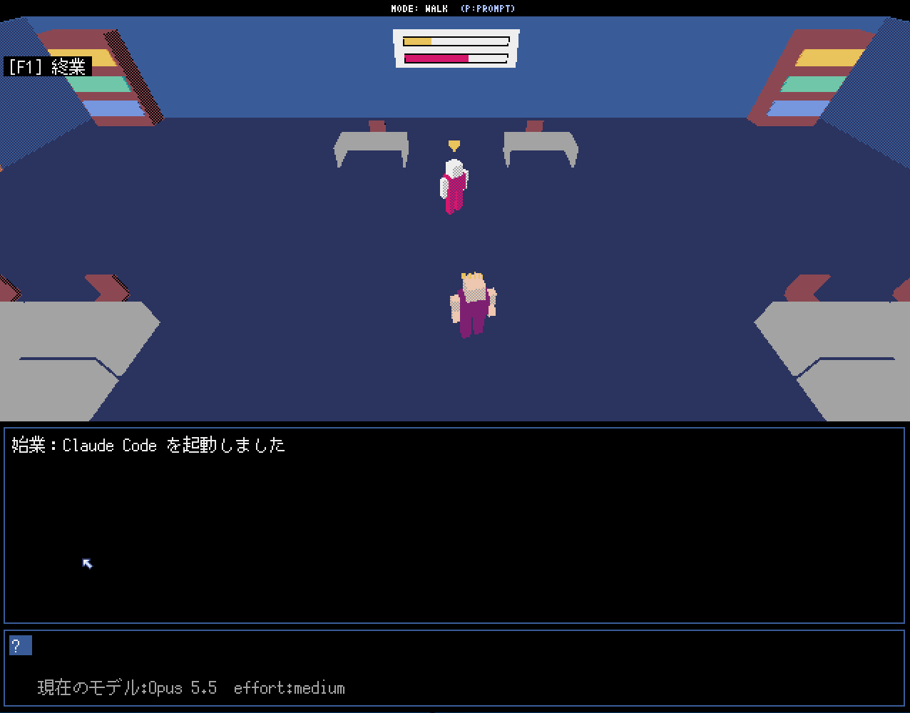

# pyxelcube_agents

日本語 | [English](README.en.md)

Pyxel Cube（Pyxel 3.0 の 3D 機能）で作った小さな 3D オフィス。キャラクターが席の周りを歩いたり、席に座ったり、目的地（コーヒー・書棚・植木）へ出かけたりする。office の配置（既定）では、tmux（1 つの端末で複数の画面を使えるソフト）上の本物の Claude Code とつながり、ツールの入力欄にプロンプトを打つと、オフィスのキャラクターが作業を始める。



版：0.90

## 重要事項

使う前に必ず読むこと。

1. **このツールは本物の Claude Code を動かす。** ツールの中で「許可（Y）」「いつも許可（A を 2 回）」を選ぶと、Claude Code はその作業（ファイルの書き換え・コマンドの実行など）を実際に行う。「いつも許可」は、内容によっては作業フォルダの `.claude/settings.local.json` にルールが追加され、ツールを閉じても残る。
2. **引数なしで起動すると、Claude Code とつなぐ状態で開く。** Claude Code が tmux の中で起動するのは F1 で始業したときだけで、ツールを起動しただけでは起動しない。つながずに眺めるだけなら `--no-claude` を付ける。
3. `/model`・`/effort` のメニューで選んだ値は、新しいセッションの既定値として Claude Code の設定に保存される。コマンドウィンドウ（`/` で始まる文を送ると開くウィンドウ）を開いている間のキーは、Claude Code にそのまま届く。`/config` などで設定を変えると、実際に変わる。
4. 利用制限を表示するため、Claude の返事が 1 回終わるたびに、ツールが tmux に `/usage` を送り、画面を読み取って閉じる。
5. ツールは tmux の画面の文字を読み取る（`capture-pane`）。画面に出たもの（ファイルの中身など）は、ツールが読み取って表示する。
6. **このツールは、Claude Code の画面に出る英語の文字列を読み取って動く。** たとえば、許可画面の `Do you want to`、`/usage` の `Current session`、ステータス行の `with medium effort` がそうである。Claude Code 2.1.330 では、language 設定や OS の言語を日本語にしても、画面は英語のままだった（実際に確かめた。変わるのは Claude の返事と、許可画面の説明文だけ）。画面が翻訳される版の Claude Code では、許可・利用制限・モデルの表示が動かなくなるおそれがある。
7. `/exit`・`/quit` はツールの入力欄から送れない。終わるときは F1 の終業（引き継ぎメモを書かせてから閉じる）を使う。ウィンドウの × でも閉じられるが、引き継ぎメモを最大 300 秒待つ。
8. 許可を受け取れるのは 1 台につき 1 つだけ。ツールを 2 つ同時に起動すると、2 つ目では許可をツールで受け取れない（tmux で答える）。
9. 非公式のツールで、Anthropic とは関係がない。Claude・Claude Code は Anthropic の商標。
10. **無保証。このツールを使って起きたことについて、作者は責任を負わない。**

## 必要なもの（Requirements）

- Linux。動作を確かめたのは Raspberry Pi 5（Raspberry Pi OS・Debian 13 ARM64）だけ。許可の受け取りに、Linux 固有の「抽象名前空間の Unix ソケット」（ファイルを作らない通信の出入り口）を使っているため、ほかの OS ではその部分の書き換えが必要になる。他のOSでもちょっとカスタマイズすればたぶん動くと思います。
- 表示は日本語・英語に対応（`--lang`）。英語の表示も作者の環境で確かめた（プロンプトは打ち込んだ言葉のまま表示される）。
- Python 3.11 以上（`tomllib` を使う）。確かめたのは 3.13.5。
- Pyxel 3.0.3。`pyxel.cube`（3D 機能）と、Pyxel に同梱のフォント PixelMplus12（`pyxel/examples/assets/PixelMplus12-Regular.ttf`）を使う。pip で入れる。
- tmux。確かめたのは 3.5a。
- inotify-tools。`inotifywait` で Claude Code の会話ログへの書き込みを監視する。
- Claude Code と、Claude のサブスクリプション。確かめた Claude Code は 2.1.330。`PermissionRequest` の hook（決まったタイミングで Claude Code が呼び出す自作コマンド）と `--settings` を使う。利用制限の表示は `/usage` を使うため、確かめたのはサブスクリプションでの利用のみ。API キーで使った場合の利用制限の表示は確かめていない。
- `python3` コマンド。hook を `python3 -I` で動かすため、PATH に `python3` があること。
- 日本語入力（任意）。fcitx5 ＋ mozc で確かめた。

## ファイルの一覧

| ファイル | 役割 |
|---|---|
| `pyxelcube_agents.py` | 本体 |
| `pca_bridge.py` | tmux・会話ログとの連携 |
| `pca_perm_hook.py` | 許可の依頼をツールへ渡す hook |
| `pca_i18n.py` | 日本語・英語の文言テーブルと、言語の切り替え |
| `pca_splash.py` | 起動時のスプラッシュ画面（Powered by Pyxel。Pyxel のロゴには Pyxel の MIT License が適用される） |
| `pyxelcube_agents.toml` | 設定ファイル |
| `README.md`・`README.en.md` | この説明書（日本語版・英語版） |
| `LICENSE` | ライセンス（MIT License） |
| `docs/method_spec.md` | メソッド別の仕様書（定数・クラス・関数とメソッドの概要・引数・戻り値・主な変数） |
| `test_pyxelcube_agents.py`・`test_pca_bridge.py`・`test_pca_perm_hook.py`・`test_pca_splash.py` | テスト（任意。動かすだけなら不要） |

これらは同じフォルダに置くこと（`pca_perm_hook.py` は本体と同じフォルダから探される）。作業フォルダ `pca_work` は起動時に自動で作られる。その中の `.claude/settings.local.json` は不要。許可の hook は起動時に `--settings` で渡され、表示の言語は環境変数 `PCA_LANG` で hook に渡る。

## インストール

`<リポジトリのフォルダ>` は、このリポジトリを `git clone` した場所。

```
cd <リポジトリのフォルダ>

# Python の仮想環境を作り、Pyxel 3.0.3 を入れる
python3 -m venv .venv
.venv/bin/pip install pyxel==3.0.3

# tmux と inotify-tools を入れる（sudo を使う手順。Debian 系の例）
sudo apt install tmux inotify-tools
```

Claude Code のインストール方法は、公式の説明に従う。

## 起動

```
cd <リポジトリのフォルダ>
.venv/bin/python pyxelcube_agents.py
```

引数なしで起動すると、Claude Code とつなぐ状態で開く。起動しただけでは Claude Code は動かない（tmux の中で起動するのは F1 で始業したとき）。F1 キー（または左上の「[F1] 始業」ボタン）で始業すると、tmux の新しいセッションで Claude Code が起動する。

作業フォルダを変えるとき（既定は `<リポジトリのフォルダ>/pca_work`）：

```
.venv/bin/python pyxelcube_agents.py --workdir <フォルダ>
```

つながずに眺めるだけなら `--no-claude` を付ける。tmux も Claude Code も使わず、見た目だけが動く（スペースキーを押すと、キャラクターが順に作業状態へ切り替わる）。

### 引数

| 引数 | 既定値 | 意味 |
|---|---|---|
| `--fps` | 30 | 目標 FPS（1〜60） |
| `--seed` | なし | 乱数シード（省略可） |
| `--layout` | office | 配置。`office`：本番に近い配置（席 18）／`proto`：試作・テスト用（机 3 つ。`--claude` は使えない） |
| `--agents` | 18 | 人数。席の数より多いときは席の数になる（office は 1〜18、proto は 1〜3） |
| `--config` | なし | 設定ファイル。省略時は本体と同じフォルダの `pyxelcube_agents.toml` |
| `--time-scale` | 1.0 | 目的地・会話のタイマーを速める倍率（0 以下は 1.0 になる）。歩く速さは変わらない |
| `--claude` / `--no-claude` | 省くと、office ならつなぐ・proto ならつながない | 本物の Claude Code とつなぐかどうか。F1 で始業・終業。proto で `--claude` をはっきり付けるとエラーになる（`--no-claude` は proto でも付けられる） |
| `--workdir` | `pca_work` | Claude Code を動かすフォルダ |
| `--session` | pyxelcube_agents | tmux のセッション名 |
| `--lang` | 環境変数で決まる | 表示の言語（`ja`・`en`） |

表示の言語は `--lang ja` か `--lang en` で選ぶ。省略すると、環境変数 `LC_ALL`、`LC_MESSAGES`、`LANG` の順に見て、最初に見つかった空でない値が `ja` で始まれば日本語、それ以外は英語になる。切り替わるのは、画面の表示、起動オプションの説明（`--help`）、終業時に Claude Code へ送る引き継ぎメモの依頼、許可を断ったときに Claude Code へ返す理由文である。Claude Code の画面そのものは切り替わらない（重要事項の 6）。

`pyxelcube_agents.toml` は、Claude Code につながないとき（`--no-claude`・proto）に、利用制限の値をどこから読み込むかを決める設定ファイル。つなぐとき（office の既定）は使われず、利用制限は `/usage` の画面から読み取る。そのまま触らなくてよい。

## はじめて使うとき

**はじめて使うフォルダでは、始業の前に、そのフォルダで自分で一度 `claude` を起動し、フォルダを信頼しておく。** 信頼の確認画面は「No, exit」が選ばれた状態で出るため、ツールからキーをそのまま送ると Claude Code が終了してしまう。

```
cd <作業フォルダ>
claude
```

信頼したら `/exit` で Claude Code を終了してから、ツールを起動する。既定の作業フォルダ `pca_work` を使う場合は、先にフォルダを作ってから信頼する。

```
cd <リポジトリのフォルダ>
mkdir -p pca_work
cd pca_work
claude
```

作業フォルダの CLAUDE.md・`.claude/commands`・skills は、通常の Claude Code と同じように効く。引き継ぎメモも作業フォルダの中に書かれる。会話ログは、`~/.claude/projects/` の中にある作業フォルダに対応するフォルダから読み込む（自動で決まる）。

## 基本の操作

操作には 2 つのモードがある。画面上部の中央に `MODE: WALK` か `MODE: PROMPT` が表示される。起動時は WALK。

| 操作 | 内容 |
|---|---|
| F1 | 始業・終業（始業していなければ始業、していれば終業） |
| P | WALK から PROMPT に切り替える（入力欄をクリックしても切り替わる） |
| Ctrl+E | PROMPT から WALK に戻る（3D 表示部をクリックしても戻れる） |
| Enter | プロンプトを送る（日本語入力の変換中は送らない） |
| Ctrl+J | 入力欄で改行する（送らない） |
| Esc | PROMPT の間は Claude Code に中断を送る。WALK の間は何もしない |
| 床のクリック | 自分の分身がそこへ歩いていく |
| 人のクリック | その人と会話する（Q で会話を終える） |
| 矢印キー | 視点を回す（左右で回転、上下で傾く） |
| マウスホイール | ズーム（履歴欄やダイアログの上では、その中をスクロールする） |
| D | REST ROOM のドアを開閉する |
| Q | 会話を終える |
| 1〜4 | 利用制限の掲示板の値を手動で変更する（Claude Code につながないときだけ） |

PROMPT の間は、Space・D・Q・矢印キーなどの 3D 操作は効かず、そのまま文字として入力欄に入力される。

### メインとの会話のダイアログ

メインをクリックすると、3D 表示部の下に会話ダイアログが開く。プロンプトとその返事を 1 ページとして表示し、プロンプトは青、返事は白で表示する。

- ↑ で前のやりとり、↓ で次のやりとりに移る（いちばん上の行に「メイン  3/12」のようにページ番号が表示される）
- 1 ページが長いときは、ホイール・スクロールバー・PageUp／PageDown で読み進める
- 始業してからのやりとりを最大 200 ページまで保存する。終業すると空になる

入力欄のいちばん下の行には、現在のモデルと effort が灰色で表示される。

### 許可の依頼が来たとき

メインの頭の上に黄色の「！」が出て、自分の分身がメインの隣へ移動し、会話ダイアログに依頼の中身が表示される。**Y と A は、Claude Code に実際に作業をさせる**（重要事項の 1）。

- Y：許可する
- N：断る
- T：tmux で答える
- A：いつも許可（「いつも許可」の候補が付いた依頼だけで使える。1 回押すと内容が表示され、もう 1 回 A を押すと確定する。ほかのキーやクリックでは取り消されるだけ）

### スラッシュコマンド・モデル・effort

- `/` から始まる文を送ると、3D 表示部に「コマンドウィンドウ」が開き、tmux の画面がそのまま表示される。ウィンドウが開いている間のキーは、本物の Claude Code に届く。
- `/model` または `/effort` だけを打つと、ツールの中に選択肢のメニューが出る。↑↓かクリックで選び、Enter で送る。Esc を押すと、何も送らずに閉じる。選んだ値は新しいセッションの既定値にも保存される。
- `/exit`・`/quit` は入力欄から送れない。

## 終わり方

- F1（または左上の「[F1] 終業」ボタン）：Claude Code に引き継ぎメモを書かせ、書き終わるまで待つ。エージェント全員を REST ROOM に戻したあと、Claude Code と tmux のセッションを閉じる。
- ウィンドウの × で閉じる：ウィンドウが消えたあとの終了処理の中で、Claude Code に引き継ぎメモを書かせて待つ。待つのは最大 300 秒で、過ぎるとメモなしで tmux を閉じる。この間は許可の依頼にツールでは答えられない（残った依頼は「断る」扱いになる）。
- Esc キーでは閉じない。

## 困ったとき

- Claude Code の画面を直接見たい：`tmux attach -t pyxelcube_agents`（`--session` で名前を変えたときはその名前）。
- 始業するときに同じ名前の tmux セッションが残っていると、ダイアログが出る。1〜3 のキーかクリックで選ぶ。
  - 1：続きから始める（そのセッションに接続する。引き継ぎメモは読まない）
  - 2：前のセッションを終了して、新しく始める
  - 3：やめる（何もせず始業前に戻る）
- 2 つの作業フォルダで同時に動かすときは、`--session` で別の名前を付ける。ただし許可を受け取れるのは 1 つだけなので、2 つ目では許可に tmux で答える（重要事項の 8）。
- 日本語入力の変換ウィンドウが出なくなった：fcitx5 を再起動すると直ったことがある（作者の環境での記録）。
- 許可の依頼がツールに届かない：ツールが動いていないときは、hook は何もせず、通常の許可画面が tmux に表示される。`python3` が PATH にあるかも確かめる。

## テストの流し方

動かすだけなら不要。本体と同じフォルダで、次の 4 つを実行する。一時ファイルは `.test_tmp/` に作られる（削除されずに残る）。

```
cd <リポジトリのフォルダ>
.venv/bin/python test_pyxelcube_agents.py
.venv/bin/python test_pca_bridge.py
.venv/bin/python test_pca_perm_hook.py
.venv/bin/python test_pca_splash.py
```

## 版の履歴

- 0.90：最初の配布

## ライセンス

MIT License（`LICENSE` を参照）。

## 謝辞

- **Pyxel**（Takashi Kitao さん・https://github.com/kitao/pyxel ・MIT License）
  このソフトは Pyxel 3.0 の 3D 機能「Pyxel Cube」を基盤として動いています。画面の表示も、キャラクターの動きも、すべて Pyxel の上で成り立っています。
- **Pixel Agents**（Pablo De Lucca さん・https://github.com/pixel-agents-hq/pixel-agents ・MIT License）
  このソフトは Pixel Agents から着想をもらい、Pyxel Cube でゼロから作り直したものです。コードと素材は流用していません。
- **PixelMplus**（itouhiro さん）
  画面の文字は、Pyxel に同梱されているフォント PixelMplus12 で表示しています。

すてきな道具とアイデアに感謝します。
